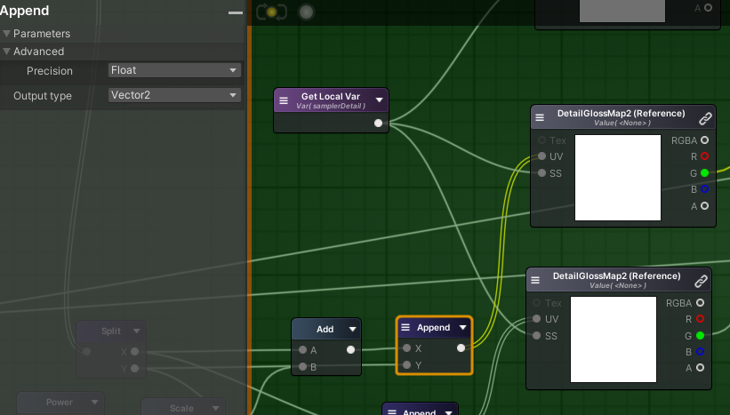

# Half Precision

Use **half** (FP16) for lighting math on mobile.

IllusionRP patches Amplify Shader Editor so each node's precision is explicit, and a value plugged into a UV port stays in **float**.

Keep texture coordinates and texture indices in float.

# World Scale

**World Scale** on Illusion Graphics is Unity units per logical meter. `10` means one logical meter is ten Unity units. Contact-shadow length, volumetric distance and subsurface radius use logical meters.

# Variable Rate Shading

**Enable Stencil VRS** builds a shading-rate image from the stencil after the transparent passes. It requires per-image-tile shading-rate support. Volumetric fog reads it through **Shading Rate**.
