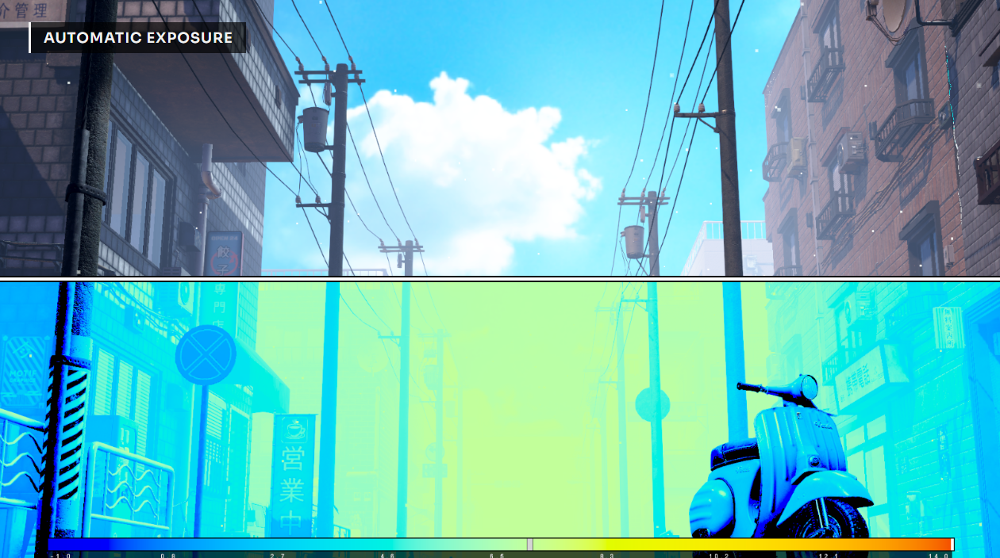
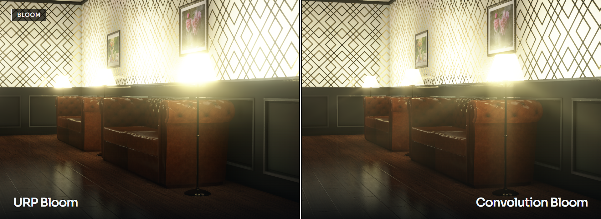
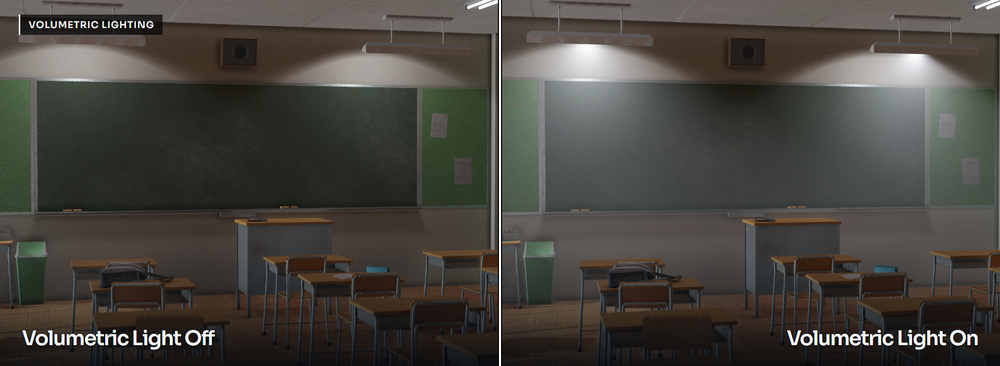
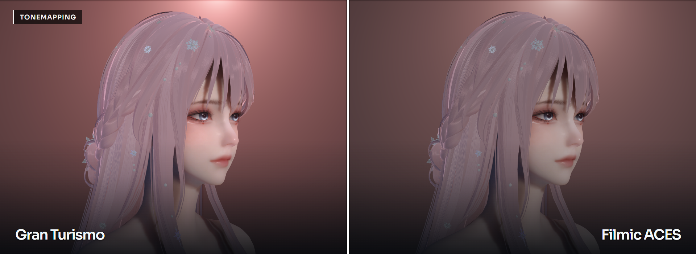

# Post-Processing

Before URP post-processing, the order is sun shafts, volumetric fog, exposure, then convolution bloom.

## Exposure

Add **Illusion/Exposure**.

| Property | Description |
|----------|-------------|
| **Mode** | **Fixed** uses **Fixed Exposure** in EV. **Automatic Histogram** measures the frame, discards luminance outside **Histogram Percentages**, and clamps to **Limit Min** / **Limit Max**. |
| **Metering Mode** | **Average**, **Spot**, **Center Weighted**, **Mask Weighted** or **Procedural Mask**. Mask Weighted uses **Weight Texture Mask**. |
| **Compensation** | EV offset on the measured exposure. |
| **Adaptation Mode** | **Fixed** snaps. **Progressive** uses separate dark-to-light and light-to-dark speeds. |
| **Target Mid Gray** | 12.5%, 14% or 18%. |
| **Scene View Prefer Fixed Exposure** | Scene view uses the fixed value. |

## Convolution Bloom

Add **Illusion/Convolution Bloom**.

| Property | Description |
|----------|-------------|
| **Quality** | **Medium** or **High**. |
| **Threshold** | Gamma-space brightness a pixel must pass. |
| **Intensity** | Strength added back to the image. |
| **Scatter** | Kernel spread. |
| **Clamp** | Maximum intensity fed into the kernel. |
| **Image PSF** | Optical kernel texture. **Generate PSF** builds a procedural kernel. |

**Update OTF** rebuilds the kernel every frame.

## Volumetric Fog

Add **Illusion/Volumetric Fog**.

| Property | Description |
|----------|-------------|
| **Distance** | Far distance, in logical meters. |
| **Base Height** / **Maximum Height** | Full density, and where density reaches zero. |
| **Enable Ground** | No density below **Ground Height**. |
| **Density** | Thickness. |
| **Attenuation Distance** | Absorption distance. Smaller values darken sooner. |
| **Anisotropy** | Positive values brighten fog when looking toward the main light. |
| **Scattering** / **Tint** | Main-light brightness and color. |
| **Enable Main Light Contribution** | Main-light scattering. |
| **Enable Additional Lights Contribution** | Local-light scattering. |
| **Enable Probe Volume Contribution** | PRT lighting, scaled by **Probe Volume Contribution Weight**. |
| **Max Steps** | Raymarch steps, 8 to 256. |
| **Blur Iterations** | Extra blurs, 1 to 4. |
| **Transmittance Threshold** | Stops a ray once remaining transmittance falls below this. Zero disables the early out. |
| **Shading Rate** | Raymarch rate. Needs variable-rate shading support. See [Optimization](Optimization.md). |

## Sun Shafts

Add **Illusion/Sun Shafts**. Add **Illusion/Sun Shaft Caster** on the transform the shafts radiate from. The default origin is the screen center.

| Property | Description |
|----------|-------------|
| **Threshold Color** | Darker pixels contribute nothing. |
| **Shafts Color** | Tint. |
| **Max Radius** | Screen-space reach. |
| **Blur Radius** | Length of each radial sample. |
| **Intensity** | Brightness. |
| **Iterations** | 1 to 4. Each iteration is two blits. |
| **Resolution** | **Low** is quarter, **Normal** is half, **High** is full. |
| **Blend Mode** | **Screen** or **Add**. |

## Advanced Tonemapping

Add **Illusion/Advanced Tonemapping**. Requires **High Dynamic Range** color grading.

| Mode | Parameters |
|------|------------|
| **None** | URP tonemapper. |
| **Gran-Turismo** | **Max Brightness**, **Contrast**, **Linear Section Start**, **Linear Section Length**. |
| **Filmic ACES** | **Slope**, **Toe**, **Shoulder**, **Black Clip**, **White Clip**. |
| **Reinhard (Luminance)** | None. |
