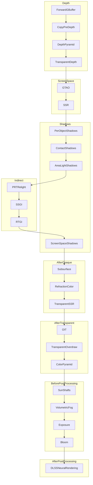

# Render Pipeline

Passes are ordered by `IllusionRenderPassEvent`. SSGI and RTGI are alternatives: an active RTGI Volume replaces SSGI on that camera.

An active Path Tracing Volume replaces this chain for that camera and runs exposure and convolution bloom.

## Limitations

`Native Render Pass` allows fewer than 20 custom passes (`ScriptableRenderer.kRenderPassMaxCount`). IllusionRP exceeds that. Leave **Native Render Pass** disabled on the renderer asset after enabling IllusionRP.
