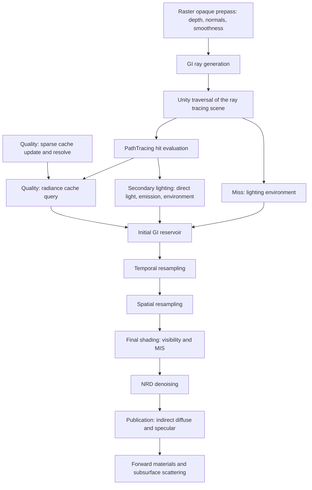

# Ray Traced Global Illumination

| Field | Value |
|---|---|
| Version | 1.4.3 |
| Status | Living |
| Date | 2026-10-18 |
| Related Specs | [Ray Tracing Scene](ray-tracing-scene.md), [Path Tracing](path-tracing.md), [Rendering Pipeline](rendering-pipeline.md), [Render Resources](render-resources.md), [Materials and Shaders](materials-and-shaders.md), [Shader Variant Stripping](shader-variant-stripping.md) |

Ray traced global illumination (RTGI) adds indirect diffuse and indirect specular lighting to raster cameras. The raster opaque prepass provides the receiving surface; rays from it are traced through the same [ray tracing scene](ray-tracing-scene.md), materials and lights as [path tracing](path-tracing.md); ReSTIR GI reuses the resulting samples across neighboring pixels and frames; NRD denoises them; and the Forward materials consume the result through the existing indirect lighting seams. Raster direct lighting, shadows, material response and subsurface scattering are unchanged.

## Scope

- **Cameras.** Raster Game base cameras and Scene View cameras on the Forward and Forward+ paths.
- **Receivers.** Opaque and alpha-tested surfaces of the Lit, Skin, Fabric and Hair families, including hand-written Hybrid Lit, and every other surface that receives SSGI, which reads the same result.
- **Transport.** Each sample's GI ray reaches a secondary surface. In Performance mode, the default, that surface is lit by direct light, its own emission and the lighting environment, for one bounce. In Quality mode, its outgoing radiance comes from SHaRC's world-space cache, which carries multiple bounces, or the path continues until the cache can answer. A ray that leaves the scene sees the lighting environment.
- **Signals.** Indirect diffuse and indirect specular, produced, denoised and composited as separate signals.

Not included:

- transparent, OIT, water and refractive receivers, which keep their existing lighting;
- caustics and specular chains, which Performance mode ends at the secondary surface and Quality mode's radiance cache does not resolve;
- ReSTIR for direct lighting at the receiver, which stays raster;
- a replacement for path tracing, whose cameras render no raster passes;
- a screen-space and ray-traced mixed mode.

## Architecture

| Decision | Consequence |
|---|---|
| Share the ray tracing scene | RTGI and path tracing see the same instances, coverage, materials, lights and environment; [Ray Tracing Scene](ray-tracing-scene.md) owns it. |
| Shade secondary surfaces as standard Lit | Secondary hits run each material's `PathTracing` entry point, so inputs, alpha clipping, shadow layers and colored transmission behave as in path tracing, and then shade Skin, Hair and Fabric as a standard Lit surface. A secondary surface is seen only through indirect light. No second material system is introduced. |
| Resample with the RTXDI SDK | Reservoirs, temporal and spatial resampling, Jacobians, bias correction and final shading use the RTXDI SDK's GI resampling; the application bridge is IllusionRP's. |
| Denoise with NRD | Diffuse and specular are denoised as separate signals with their own hit distances, normals, roughness and history. |
| Integrate through the raster seams | Receivers come from the opaque prepass, lights that raster evaluates are not repeated, misses see the lighting environment, and specular composes with SSR and reflection probes without counting any part of the lobe twice. |
| Publish demodulated signals | Materials keep applying their own albedo, Fresnel, FGD, occlusion and layer multipliers exactly once, as they do for SSGI and SSR. The diffuse signal needs no receiver albedo. |
| Offer Performance and Quality modes | Performance mode lights the secondary surface once, by light sampling alone. Quality mode continues the path for multiple bounces. |
| End Quality paths in SHaRC | The raster receiver is the primary surface and the GI ray's hit is the first indirect bounce, where the cache may be queried. The cache's update, resolve and query passes run unchanged, at the cost of voxel-scale averaging and lag at secondary surfaces. |

## Receiver

- **Surface.** The receiving surface is the opaque raster surface: the camera depth before transparent post-depth, the camera normals and the Forward GBuffer smoothness. Positions are reconstructed through the projection the camera depth was rendered with, jitter included, so perspective, orthographic, lens shifted and oblique cameras all receive where raster drew. The view direction points toward the camera position, or against the camera's forward direction for an orthographic camera. Pixels at the far plane are invalid and produce no sample.
- **Normal.** The receiver normal is the camera normal, including GBuffer normal overrides and wet normals. Skin's low-frequency ambient normal and the original normal that wet surfaces keep for indirect diffuse are approximated by it. It also serves as the geometric normal for the sampling hemisphere and ray offsets; ray origins are offset far enough to clear the reconstruction precision, which falls with distance.
- **Material.** No receiver material record beyond the Forward GBuffer smoothness exists. Both signals are demodulated, so the receiver is shaded with a white diffuse albedo and a white specular reflectance, and its own albedo, reflectance and Fresnel are applied by the Forward materials. Specular is evaluated with a small minimum perceptual roughness.

## Secondary surfaces

- **Traversal.** GI rays and their visibility rays traverse the ray tracing scene with path tracing's instance masks, coverage and shadow layer rules. Visibility rays return colored transmission. In Performance mode, GI rays pass through every surface that transmits shadows, transparent surfaces and Lit's thin and refractive transmission; final shading's visibility test still applies their colored transmission.
- **Material.** A secondary hit evaluates its material inputs through its `PathTracing` entry point. Skin, Hair and Fabric are then reduced to a standard Lit surface: diffuse color, specular color, perceptual roughness, shading normal and emission. Skin loses subsurface scattering and its second specular lobe, Hair its strand lobes and dual scattering, and Fabric its sheen, anisotropy and transmission. In Performance mode Lit is reduced the same way: it keeps its coat and loses transmission, and every specular lobe, the coat included, is clamped to a high minimum perceptual roughness. In Quality mode Lit keeps its own model, including coat and transmission. Path tracing keeps the full material model.
- **Ray kind.** GI rays are scattered rays, not camera chains: Unlit surfaces contribute only their baked emission, and multiply overlays and camera-only backdrops are passed through.
- **Lighting.** The secondary vertex is lit with the [path tracing lighting contract](path-tracing.md#lighting-and-path-integration): next-event estimation over the shared light set (directional, point, spot and rectangle lights, emissive geometry and the environment), physical attenuation, no range cutoff or cookies, and rendering layer semantics evaluated for the secondary renderer. In Performance mode light sampling alone lights the secondary surface, which scatters no ray. In Quality mode, every vertex that the cache does not resolve also scatters a ray, as a path tracing vertex does, and combines light sampling by MIS with the emission that ray reaches. Light sampling is always on, whatever the Path Tracing Volume selects.
- **Raster lights.** A GI ray from the receiver that reaches the emitter of a light that raster evaluates directly, such as a rectangle light proxy or a directional light's disc, adds no radiance. Those lights reach the receiver only through secondary surfaces. Emissive geometry and the lighting environment are not raster lights and contribute when reached.
- **Environment.** Rays that leave the scene see the lighting environment, never the camera background.
- **Estimate controls.** The luminance of each initial sample's radiance is clamped before resampling, so that rare caustic paths, such as a glossy surface reflecting the sun toward a diffuse receiver, do not spread through reuse. The limit is configurable and relative to the current exposure. Disabling the clamp keeps the estimate unbiased.

## Radiance cache

Quality mode only.

- **Cache.** Each camera owns one SHaRC cache, cleared when created and on every history reset. Its grid is centered on the camera position, with voxels that grow with distance from the camera. Entries store outgoing radiance including albedo, without material demodulation. An entry leaves out its surface's own emission, so that light sampling's MIS stays intact: an update path passes on the emission a hit adds to the vertex before it, and emissive hits are never queried.
- **Update.** Each frame, a sparse random subset of receivers traces update paths. Its GI ray leaves the receiver as an initial sample's does. Every hit is shaded with Quality mode's secondary-surface material and lighting contract, with every specular lobe, the coat included, clamped to a minimum perceptual roughness, adds its light sampling and emission to the cache, and continues by sampling its BSDF up to a bounded path length. The cache's resampling ends paths early. A miss adds the lighting environment. The receiver is not cached, and the GI ray from it follows the raster light rule.
- **Resolve.** Every entry is resolved each frame, accumulating over a bounded number of frames and evicting entries that stop receiving samples.
- **Query.** An initial sample queries the cache at its GI ray's hit when both the segment and the footprint of the receiver lobe that launched it are larger than the cache voxel there. A cached value becomes the sample's secondary radiance and ends the path. Otherwise the hit is lit and scatters as a path tracing vertex, and the next hit is queried with the same tests, up to the same bounded path length. Emissive hits, raster light emitters included, are not queried and stay path tracing vertices, so that their emission keeps its weight against light sampling; a raster light's emitter reached from the receiver still adds no radiance.
- **Requirements.** The cache needs native 16-bit shader types and 64-bit buffer atomics. A device without them runs RTGI in Performance mode and reports it once.

## Resampling

- **Initial sample.** Each valid receiver pixel traces one GI ray per frame, sampling a mixture of the diffuse and specular lobes whose density accounts for both. Without specular, every ray samples the diffuse lobe. The sample is the secondary point, its normal and its outgoing radiance toward the receiver. A reflection sampled below the receiver contributes nothing but still counts as a sample, so resampling averages over every sample the lobes generate.
- **Temporal.** Temporal resampling reprojects each receiver with the camera's motion vectors, which carry object and skinned motion; a camera without motion vectors reprojects through the previous frame's camera. Previous receivers are rebuilt through the same reconstruction as current ones, so a receiver that did not move is the same point in both frames. Previous receivers are accepted by depth, normal and material similarity, bounded by a maximum history length and a maximum history age. The age counts the frames since the pixel's history restarted, not since its sample was selected.
- **Spatial.** Spatial resampling draws neighbors within a configured radius and sample count with the same similarity tests.
- **Bias correction.** Off, Basic or Ray traced, per resampling stage. Ray traced, the default, accounts for occlusion between a receiver and its neighbors' samples.
- **Final shading.** Final shading reads the output of the last enabled resampling stage, re-tests visibility, and combines the resampled sample with the initial sample by MIS.
- **Measures.** Reconnection Jacobians use the secondary point and its geometric normal. Reservoir weights and the final estimator use the same target function.

## Denoising

- **Denoiser.** NRD RELAX by default, REBLUR selectable: the diffuse variant while only diffuse is produced, the diffuse and specular variant with specular. None publishes the resampled signal undenoised, for validation.
- **Inputs.** View depth, motion, normal and roughness, and radiance with hit distance per signal, all at the GI resolution and in the denoiser's conventions. In checkerboard mode the denoiser receives only the traced field, and its active field matches the one resampling traced. The inputs describe the same frame, view and jitter. Motion is the camera's motion vectors; a camera without them gives NRD no surface motion, and NRD takes the camera motion from the view matrices.
- **Backend.** The backend is optional. It exists only when the UnityRHI package is installed, only for the Editor and Windows x64, and runs only on Direct3D 12. The native library and its shader front end are pinned together as defined by [Third-Party Source Imports](third-party-source-imports.md#pinning).

## Output and composition

- **Diffuse.** The diffuse signal is scene-linear incident irradiance at the receiver in the normalization that SSGI publishes, not multiplied by any receiver albedo. It is published pre-exposed through the indirect diffuse seam that SSGI uses, marked as ray traced, so every receiver that reads SSGI reads it unchanged: materials apply their diffuse color, FGD, ambient occlusion, wet ambient factor and rendering layer multiplier once, and Skin takes it through `SubsurfaceDiffuse` into subsurface scattering. It replaces the SSGI, probe or baked diffuse that the receiver would otherwise use; lightmapped receivers keep their lightmaps, as with SSGI. Precomputed radiance transfer reflection normalization is unaffected.
- **Specular.** The specular signal is the incident radiance averaged over the receiver's white specular lobe, the same quantity SSR provides, so materials apply their own FGD. It is published pre-exposed through the SSR lighting seam: valid SSR hits keep their weight, RTGI specular covers the rest of each receiver, and reflection probes cover only what neither provides. A receiver is a pixel with a valid RTGI receiver that SSR traces ([Materials and Shaders](materials-and-shaders.md#stencil)) and that no transparent post-depth surface covers; Skin and Hair, which SSR does not trace, keep their reflection probes. No part of the lobe is counted twice.
- **Validity.** Validity is carried separately from color; a valid black result is not replaced by a fallback.
- **Resolution.** GI tracing, resampling and denoising run at full or half resolution. A half resolution pixel takes its receiver from one camera texel of its block, and both signals are upsampled to the camera size with depth-aware weights before publication, as SSGI's half resolution is.
- **Checkerboard.** While a denoiser runs, a checkerboard mode can trace, resample and shade only half of the GI pixels each frame, alternating the field every frame; reservoirs cover that half. The denoiser reconstructs the other half, and the published signals cover every pixel. Without a denoiser every GI pixel is traced.

## Enablement

| Feature | Requires | Off for a camera |
|---|---|---|
| Ray traced global illumination | The renderer capability, the runtime switch and an enabled RTGI Volume; Forward or Forward+; ray tracing and Direct3D 12 support; the selected denoiser's backend is available; Game base or Scene View camera; not path traced. | The camera uses SSGI when that applies, otherwise no indirect diffuse override; RTGI specular is absent from the SSR seam. |

- **Precedence.** When both SSGI and RTGI apply to a camera, RTGI is used and SSGI does no work.
- **Variants.** RTGI makes the screen-space global illumination and SSR material states reachable. The opaque SSR stage then runs for every eligible camera, so the SSR seam is black where neither SSR nor RTGI specular applies.
- **Volume.** The RTGI Volume selects the estimate: mode, resolution, checkerboard, specular, resampling, bias correction, radiance clamp and denoiser. Performance mode, half resolution, checkerboard and specular are the defaults. Quality mode adds the per-camera radiance cache. With specular off, the diffuse signal is the one the receiver's diffuse sampling produces, and the SSR seam carries SSR alone.
- **Unavailable backend.** An unavailable device or denoiser backend reports its reason once and leaves the camera on its non-RTGI path.
- **Validation.** In the Editor and development builds, a validation switch averages the published result over frames while the view, scene and lights stay unchanged, so it converges to the estimate it is sampling.
- **Radiance cache views.** In the Editor and development builds, debug views replace the final image of a Quality mode camera with its radiance cache: the voxel and level of each receiver, the occupancy of the hash table, and how far each receiver's lookup probes. Performance mode cameras keep their image.

## Frame order

| Event | Work |
|---|---|
| After the opaque prepasses | RTGI: in Quality mode the radiance cache update and resolve, then ray generation, secondary lighting, resampling, final shading, denoising, diffuse publication in place of SSGI, and specular merged into the opaque SSR result, which is published before opaque rendering. |

RTGI cameras request the [ray tracing scene](ray-tracing-scene.md#update) before culling.

## History and lifecycle

- **Per camera.** Quality mode's radiance cache, the reservoirs, secondary surface records, the previous receiver depth, normal and roughness with the previous view, and the NRD instance with its history belong to one camera.
- **Reset.** History resets on the camera's first frame, a camera cut (a large move or turn), a size, resolution mode or checkerboard change, a gap of more than a few rendered frames such as a switch to path traced rendering, and any change to the estimate's definition such as the mode, resampling mode, denoiser, radiance clamp or participation layers. A reset also clears the radiance cache. Normal motion is reprojected, not reset.
- **Release.** A camera's RTGI state is released once the camera has not rendered RTGI for a short grace period; disposing the feature releases every instance. The denoiser targets exist only while a denoiser runs, and the validation accumulation targets only while accumulation is on, so a camera without RTGI runs no RTGI work and keeps no RTGI resources beyond that delay.

## Build

An RTGI capability aggregated from renderer settings keeps the `PathTracing` material passes, the ray tracing scene support shaders and the SSGI and SSR material states it reaches. [Shader Variant Stripping](shader-variant-stripping.md#resource-stripping) owns the rules.

## Validation

- In a furnace scene, converged RTGI diffuse matches path tracing Reference limited to the same transport depth: the secondary vertex in Performance mode, the cache's bounded path length in Quality mode.
- In a character scene with skin, hair and fabric, converged RTGI matches that reference without receiver albedo or Fresnel applied twice, and without raster lights counted twice.
- Skinned characters in motion, camera cuts, resizes and switches between path traced and raster cameras produce no stale history.
- With RTGI off, SSGI, SSR, precomputed radiance transfer, wet surfaces, subsurface scattering and path tracing are unaffected.
- A player built with only RTGI keeps the passes and support shaders it needs, and a player built without it strips every RTGI shader that a build callback can reach.
